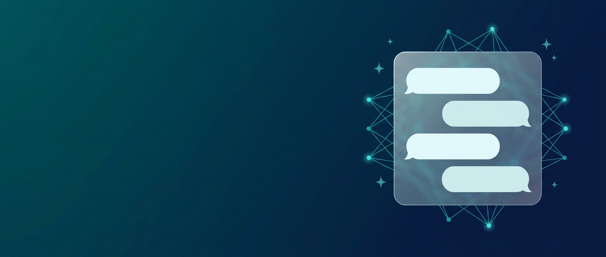

# پاسخ‌بان

**دستیار هوشمند و گفت‌وگوی آنلاین وردپرس — فارسی، راست‌چین، با ظاهر شیشه‌ای**

یک باکس گفت‌وگو در همهٔ صفحات سایت که اول خودش از روی محتوای واقعی سایت جواب می‌دهد،
هرجا نتوانست اپراتور انسانی را وارد می‌کند، و مکالمه را در اینباکس پیشخوان نگه می‌دارد.

---

> ### این مخزن **ویترین** است، نه سورس.
> فایل‌های PHP، JS، CSS و بستهٔ نصب (ZIP) اینجا منتشر **نمی‌شوند**.
> هر چه در این مخزن می‌بینید معرفی محصول، راهنمای کاربری، پرسش‌های متداول، گزارش تغییرات نسخه‌ها و
> سیاست امنیتی است. دریافت افزونه فقط از طریق سایت اتحاد وردپرس و برای مشتریان دارای لایسنس انجام می‌شود —
> ببخش [دریافت و به‌روزرسانی](#دریافت-و-به‌روزرسانی).

---

## چرا پاسخ‌بان

| دغدغهٔ معمول | پاسخ پاسخ‌بان |
|---|---|
| «باکس چت فقط فرم تیکت است» | پاسخ‌بان از محتوای واقعی سایت (نوشته‌ها، برگه‌ها، محصولات) جواب می‌سازد، نه پاسخ آمادهٔ ثابت |
| «هوش مصنوعی چیزهایی می‌گوید که ما نگفتیم» | پاسخ فقط از ایندکس دانش سایت ساخته می‌شود و لینک منبع نشان می‌دهد؛ اگر منبع نباشد، صادقانه می‌گوید نمی‌داند |
| «مشتری باید منتظر بماند» | هر زمان لازم باشد اپراتور انسانی از اینباکس وارد همان مکالمه می‌شود و آن گفت‌وگو از هوش مصنوعی جدا می‌شود |
| «همه‌چیز انگلیسی و چپ‌چین است» | رابط فارسی و راست‌چین، تقویم شمسی، ارقام فارسی، ساعت کاری ایران، پیامک و کانال بله |
| «داده‌هایم می‌رود بیرون» | کلید سرویس هوش مصنوعی فقط روی سرور شما می‌ماند؛ متن گفت‌وگوها در دیتابیس وردپرس خودتان |

## قابلیت‌ها

**گفت‌وگو و دستیار**
- باکس شناور در همهٔ صفحات با نمای شیشه‌ای، حالت روشن/تاریک خودکار و اندیکاتور «مغز در حال تفکر»
- پاسخ بر پایهٔ محتوای سایت با جست‌وجوی معنایی برداری (سؤال‌های هم‌معنی به همان منبع درست می‌رسند)
- نشان‌دادن منابع هر پاسخ، پاسخ روان (جریان نوشتاری) و فرم پیش‌گفت‌وگو برای گرفتن نام و شماره
- ورودی صوتی و خروجی صوتی با موتور گفتار مرورگر

**اپراتور انسانی و اینباکس**
- اینباکس کامل در پیشخوان: جست‌وجو، نشانگر خوانده‌نشده، برچسب، «اپراتور در حال نوشتن…»
- دستیار اپراتور: پیشنهاد پاسخ، خلاصهٔ مکالمه و لحن قابل انتخاب
- ارسال تصویر و فایل در چت (کشیدن‌ورهاکردن یا چسباندن) و نمایش همان ضمیمه در اینباکس
- تیم پشتیبانی: نقش اختصاصی اپراتور، واگذاری نوبتی مکالمات، ساعت کاری و پاسخ خودکار بی از ساعت کاری

**ووکامرس**
- اندیکس محصولات با قیمت و وضعیت موجودی، برای پاسخ‌های دقیق فروشگاهی
- استعلام امن وضعیت سفارش توسط مشتری؛ شناسهٔ سفارش هرگز مبنای دسترسی قرار نمی‌گیرد

**اعلان‌ها و بومی‌سازی**
- تلگرام، بله (اعلان و پاسخ دوطرفه)، ایمیل و پیامک (کاوه‌نگار، ملی‌پیامک، پیامک.آی‌آر)
- نظرسنجی رضایت (CSAT) پس از پایان گفت‌وگو
- تقویم شمسی و ارقام فارسی در اینباکس، مخاطبین، آمار و فایل‌های CSV

**مدیریت و عیب‌یابی**
- صفحهٔ «بررسی سلامت» با ۳۷ بررسی که مسیرها را واقعاً می‌آزماید و راهنمای رفع فارسی می‌دهد
- صادر/وارد کردن تنظیمات به شکل فایل JSON برای راه‌اندازی روی چند سایت
- برندسازی سفید: نام، لوگو، لینک و پابرگ قابل تغییر؛ حذف کامل نام «پاسخ‌بان» از رابط کاربری
- آمار پرکاربردترین سؤال‌ها، نرخ پاسخ خودکار و وضعیت مکالمات

## ساختار صفحهٔ تنظیمات

ده تب، همه در یک فرم واحد با نوار ذخیرهٔ چسبان و جست‌وجوی زندهٔ میان تنظیمات:

`عمومی` · `اتصال` · `دستیار و دانش` · `چت آنلاین` · `ظاهر` · `اعلان‌ها` · `تیم` · `امنیت و داده` · `ویجت مغز` · `بررسی سلامت`

## نیازمندی‌ها

| مورد | حداقل | یادداشت |
|---|---|---|
| وردپرس | ۵.۸ | تست‌شده تا ۶.۶ |
| PHP | ۷.۴ | `curl` و `json` فعال |
| HTTPS | لازم | برای کوکی‌های امن و ورودی صوتی مرورگر |
| سرویس هوش مصنوعی | یکی از سازندگان سازگار با API گپ‌جی‌پی‌تی | گپ‌جی‌پی‌تی، کلود، جمینای و سرویس‌های ایرانی سازگار با این API |
| ووکامرس | اختیاری | فقط برای بخش استعلام سفارش و محصولات |

## دریافت و به‌روزرسانی

1. از [etehadwp.com/pasokhban](https://etehadwp.com/pasokhban) بستهٔ ZIP نسخهٔ خودتان را بگیرید.
2. پیشخوان وردپرس ← افزونه‌ها ← «بارگذاری افزونه» ← انتخاب فایل ZIP ← «الان نصب کن».
3. برای نسخه‌های بعد همان فایل جدید را روی نسخهٔ قبلی نصب کنید: وردپرس جایگزین می‌کند و
   **تنظیمات، مکالمات، مخاطبین و ایندکس دانش حفظ می‌شوند**.
4. ساختار بسته استاندارد است (پوشهٔ ریشهٔ `pasokhban`) تا «بارگذاری افزونه» و به‌روزرسانی دستی بدون خطا کار کند.

دو نکته که زیاد پرسیده می‌شود:
- **غیرفعال کردن** افزونه هیچ تنظیمات یا جدولی را حذف نمی‌کند.
- **حذف کامل** افزونه هم فقط در صورتی داده‌ها را پاک می‌کند که در تنظیمات ← «امنیت و داده» گزینهٔ
  «حذف داده‌ها هنگام حذف پلاگین» را روشن کرده باشید. پیش از هر حذف، از بخش «صادر کردن تنظیمات» فایل JSON بگیرید.

## امنیت و حریم خصوصی

- کلید API سرویس هوش مصنوعی **هرگز** به مرورگر بازدیدکننده فرستاده نمی‌شود؛ درخواست‌ها از سمت سرور ارسال می‌گردد.
- اندپوینت‌های گفت‌وگو با محدودیت تعداد درخواست به‌ازای هر IP محافظت می‌شوند و ورودی‌ها اعتبارسنجی و ضدکدگذاری می‌شوند.
- فایل ضمیمه چهار لایه بررسی دارد: فهرست سفید پسوند، بررسی نوع واقعی محتوا، نام تصادفی فایل و قفل پوشهٔ آپلود.
  فایل برداری SVG عمداً مجاز نیست، چون می‌تواند اسکریپت داشته باشد.
- بازدیدکننده هرگز نشانی فایل را به سرور نمی‌فرستد؛ برای هر آپلود یک توکن یک‌بارمصرف داده می‌شود تا
  هیچ‌کس نتواند فایل دلخواهی را به‌عنوان ضمیمه جا بزند.
- استعلام سفارش ووکامرس با لینک یک‌بارمصرف و نشانهٔ زمان‌دار انجام می‌شود.
- گزارش آسیب‌پذیری فقط از راه [SECURITY.md](SECURITY.md) — نه در ایشوی عمومی.

## مستندات

| سند | محتوا |
|---|---|
| [راهنمای کامل فارسی (PDF)](docs/pasokhban-guide-fa.pdf) | نصب، راه‌اندازی هشت‌مرحله‌ای، عیب‌یابی |
| [راهنمای متنی](docs/guide-fa.md) | همان راهنما، قابل خواندن در گیت‌هاب و صفحهٔ گیت‌هاب پیجز |
| [پرسش‌های متداول](docs/faq-fa.md) | لایسنس، داده‌ها، سازگاری، به‌روزرسانی |
| [گزارش تغییرات](CHANGELOG.md) | چه چیزی در هر نسخه عوض شده |
| [پشتیبانی](SUPPORT.md) | channels، مدارک موردنیاز تیکت، زمان پاسخ |
| [راهنمای آنلاین](https://etehadwp.com/pasokhban/guide.html) | نسخهٔ تعاملی روی سایت |

## آنچه این مخزن عمداً منتشر نمی‌کند

- کد افزونه (PHP، JS، CSS) و بستهٔ ZIP — توسعه در مخزن خصوصی انجام می‌شود و فقط خروجی امضاشده به مشتری داده می‌شود.
- هیچ کلید API، توکن ربات، شمارهٔ سرور یا نشانهٔ داخلی در این مخزن نیست و نخواهد بود.
- لاگ‌ یا گزارش تشخیصی واقعی سایت‌ها در ایشوها پیوست نشود؛ گزارش متنی «بررسی سلامت» امن است، چون کلیدها را می‌پوشاند.

## مشارکت

کد افزونه بسته است، بنابراین پلی‌درخواست پذیرفته نمی‌شود.
پیشنهاد ویژگی، گزارش باگ، بازبینی متن‌ها و ترجمه از راه [ایشو](https://github.com/etehadwp/pasokhban/issues/new/choose) به‌طور مستقیم به محصول اضافه می‌شوند — ببخش [CONTRIBUTING.md](CONTRIBUTING.md).

## لایسنس

افزونه یک محصول تجاری اتحاد وردپرس است و سورس آن منتشر نمی‌شود. متن کامل در [LICENSE.md](LICENSE.md).

---

**پاسخ‌بان** — محصول [اتحاد وردپرس](https://etehadwp.com)
[وب‌سایت](https://etehadwp.com) · [راهنما](https://etehadwp.com/pasokhban/guide.html) · [پشتیبانی](SUPPORT.md)

